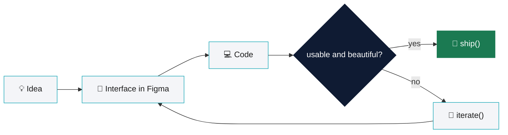

<div align="center">


<br/><br/>

<a href="https://moinulrehan.framer.ai/"></a>
<a href="https://www.behance.net/moinul_rehan"></a>
<a href="https://dribbble.com/moinul-rehan"></a>
<a href="https://www.linkedin.com/in/moinul-rehan/"></a>
<a href="https://x.com/moinul_rehan"></a>
<a href="mailto:rehan.moinul.10@gmail.com"></a>

<br/>


<br/><br/>

[About](#about) · [Toolkit](#toolkit) · [Featured Work](#featured-work) · [GitHub Activity](#github-activity) · [Contact](#contact)

</div>

<br/>


<a name="about"></a>

## 𝟬𝟭. About 

<table>
<tr>
<td width="60%" valign="top">

I design digital products that feel effortless to use, then get close enough to the code to make sure they actually ship that way.

- 💼 **UI/UX Designer** at Tulip Tech
- 🧩 **2+ years** designing web & mobile products
- 📦 **25+ client projects** delivered, research to handoff
- 🎯 Focused on clarity, systems thinking, and interaction detail
- 🛠️ Comfortable translating Figma into real front-end components

<sub>CURRENTLY DESIGNING AT</sub><br/>
<picture>
  <source media="(prefers-color-scheme: dark)" srcset="./assets/tuliptech-logo-dark.png">
  
</picture>

</td>
<td width="40%" valign="top" align="center">

```
if (design == usable
    && beautiful) {
  ship();
} else {
  iterate();
}
```

</td>
</tr>
</table>

<details>
<summary><b>🔁 The loop above, as a diagram</b> (click to expand)</summary>

<br>



</details>


<a name="toolkit"></a>

## 𝟬𝟮. Toolkit 

<div align="center">


<br/>


</div>

<br/>

<div align="center">

| 🎨 Design | 🤖 AI &amp; Workflow | 🤝 Collaboration |
|:---:|:---:|:---:|
| Figma · Photoshop · Illustrator | Claude · Codex · Antigravity | Framer · Notion · Miro · GitHub |

</div>


<a name="featured-work"></a>

## 𝟬𝟯. Featured Work 

<div align="center">

<a href="https://moinulrehan.framer.ai/">

</a>

<br/><br/>

<table>
<tr>
<td align="center" width="33%">

**🎨 Behance**
<br/>
Case studies & full project breakdowns
<br/>
<a href="https://www.behance.net/moinul_rehan">behance.net/moinul_rehan</a>

</td>
<td align="center" width="33%">

**🏀 Dribbble**
<br/>
UI shots & visual explorations
<br/>
<a href="https://dribbble.com/moinul-rehan">dribbble.com/moinul-rehan</a>

</td>
<td align="center" width="33%">

**🔗 Portfolio**
<br/>
Full case studies, start to finish
<br/>
<a href="https://moinulrehan.framer.ai/">moinulrehan.framer.ai</a>

</td>
</tr>
</table>

</div>


<a name="github-activity"></a>

## 𝟬𝟰. GitHub Activity 

<div align="center">


<br/>


</div>

<details>
<summary><b>📈 Contribution graph</b> (click to expand)</summary>

<br>

<div align="center">


</div>

</details>

<details>
<summary><b>🧮 More stats</b> (click to expand)</summary>

<br>

<div align="center">


<br/>


</div>

</details>


<a name="contact"></a>

<div align="center">

### Let's build something people actually enjoy using.

📫 **[rehan.moinul.10@gmail.com](mailto:rehan.moinul.10@gmail.com)**

<br/>

Made in Dhaka 🇧🇩 by **Moinul Islam Rehan** · Designing at **Tulip Tech**


</div>
